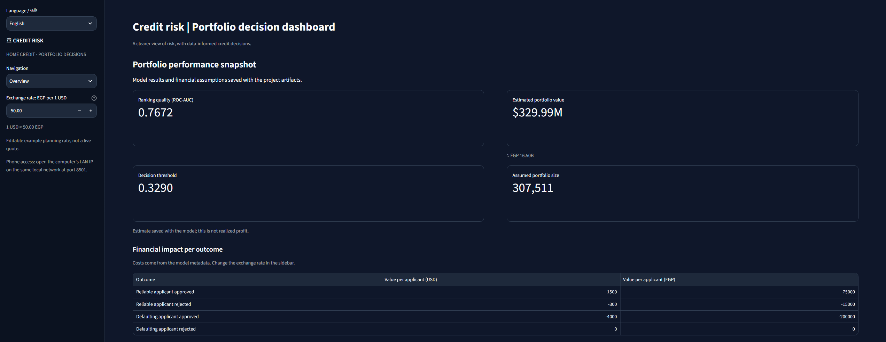

# Credit Risk

[🚀 **Open the live Streamlit app**](https://youssefelbahey4-crypto-home-credit-risk-assessment-4isz7n.streamlit.app/)



*Portfolio overview with validation score, decision threshold, estimated value, and USD/EGP outcome values.*

This project uses **machine learning** to estimate whether a loan **applicant** may have **payment difficulties**. It then shows how different approval choices could affect a sample portfolio (محفظة تمويل افتراضية).

The app is available in Arabic and English. It is an educational project, not a ready-to-use bank lending system.

## A quick guide to the terms

- **Default :** difficulty repaying a loan.
- **Feature :** an input the model uses, such as income or age.
- **Target :** in this dataset, `TARGET = 1` means payment difficulties and `TARGET = 0` means no recorded difficulties.
- **Validation data (بيانات اختبار لم يستخدمها التدريب):** data used to check how well a trained model ranks applicants.
- **ROC-AUC (مقياس قدرة النموذج على ترتيب المخاطر):** higher is better; 0.5 is about random ranking, and 1.0 is perfect ranking. It does not tell us whether every probability is correct.
- **Threshold (حدّ القرار):** the probability level used to flag an application as higher risk.
- **Confusion matrix (جدول مقارنة التوقّعات بالنتائج الحقيقية):** counts correct and incorrect approvals and rejections.

## What the app does

- **Portfolio overview (ملخص المحفظة):** shows saved model results, the decision threshold, estimated scenario value, and the cost assumptions in USD and EGP.
- **Value simulator (محاكي القيمة):** enter counts of correct or incorrect approvals and rejections to see the estimated value under the assumptions below.
- **Applicant scoring (تقييم الطلبات):** score one example applicant or upload a CSV file to score a group, then download the results.
- **SHAP explanation (تفسير أسباب نتيجة النموذج):** shows which supplied applicant details moved the model's risk score up or down.
- **Language and phone access:** switch between Arabic and English. For local phone access, the phone and computer need to be on the same private network.

## Model results

### Main experiment — `notebooks/main01.ipynb`

The notebook compares models on its validation data. The first three rows show how adding credit-history information changed the Logistic Regression model; the remaining rows compare different model types.

| Model and experiment | Validation ROC-AUC (ترتيب المخاطر) |
|---|---:|
| Logistic Regression baseline | 0.6878 |
| Logistic Regression + bureau history | 0.6917 |
| Logistic Regression + bureau and previous applications | 0.6946 |
| Decision Tree | 0.7093 |
| Random Forest | 0.7439 |
| XGBoost before tuning | 0.7659 |
| **Tuned XGBoost (أفضل إعدادات جرى اختيارها بالتجربة)** | **0.7677** |

### Second experiment — `notebooks/credit_risk.ipynb`

This notebook runs a separate comparison. Its validation results are:

| Model | Validation ROC-AUC |
|---|---:|
| Logistic Regression | 0.6621 |
| Decision Tree | 0.7109 |
| Random Forest | 0.7422 |
| **Tuned XGBoost (إعدادات محسّنة بالتجربة)** | **0.7672** |

The two notebooks report different numbers because they are separate experiments with different data preparation and model settings. Compare models **within the same notebook**; do not treat the two tables as one shared test. The current saved dashboard metadata reports ROC-AUC **0.7672**. Re-run and export one final model version before publishing a single headline score.

### What is the difference between the models?

- **Logistic Regression :** a simple, fast starting point. It works best when the relationship between inputs and risk is fairly straightforward.
- **Decision Tree :** follows a sequence of “if this, then that” rules. One tree is easier to picture, but can miss more complicated patterns.
- **Random Forest :** combines many decision trees. Their combined vote is often stronger than one tree, but the full model is harder to explain.
- **XGBoost :** builds trees in stages; each stage tries to correct earlier mistakes. It scored highest in these notebook experiments, but is more complex to understand.
- **Tuning :** trying different model settings and keeping the best validation result. In `main01.ipynb`, tuning raised XGBoost from 0.7659 to 0.7677.

---

## 🔄 Project Workflow

### 1. Data collection
The dataset used in this project is sourced from the official **[Kaggle Home Credit Default Risk Competition](https://www.kaggle.com/c/home-credit-default-risk/data)**. Place `application_train.csv`, `bureau.csv`, and `previous_application.csv` in `data/raw/`.

---

### 2. Initial data check
Inspect the table sizes, column types, missing values, duplicates, and target balance. The notebook reports 307,511 application rows and an approximately 8.07% default rate.

---

### 3. Data cleaning
Remove columns with more than 65% missing values. Flag the unusual `DAYS_EMPLOYED = 365243` value and replace it with a missing value for later handling.

---

### 4. Prepare model inputs
Convert category text to numbers and fill missing values using statistics learned from training data.

---

### 5. Add credit-history information
Group bureau and previous-application records by `SK_ID_CURR`, calculate summary values, and join them to each applicant.

---

### 6. Split and train
Keep a validation set aside, then compare Logistic Regression, Decision Tree, Random Forest, and XGBoost.

---

### 7. Improve and compare models
Tune XGBoost settings with cross-validation (اختبار متكرر على أجزاء من بيانات التدريب) and compare ROC-AUC scores within each notebook run.

---

### 8. Choose a decision threshold
Compare the standard probability cutoff and statistical measures with the financial cost assumptions.

---

### 9. Explain and review results
Inspect global and individual SHAP contributions, plus the confusion matrix (جدول التوقعات الصحيحة والخاطئة) and estimated financial impact.

---

### 10. Save the app files
Export the trained model, imputer, feature names, and decision metadata to `models/` for the Streamlit dashboard.

---
The shared feature code summarizes bureau and previous-application history. It does not summarize credit-card balance history. Notebook metrics are experiment results, not proof that the model is ready for real lending.

## Business problem and sample costs (مشكلة التمويل والتكاليف الافتراضية)

The model estimates risk; a separate cost matrix (جدول افتراضات الخسارة والقيمة) shows why the decision threshold matters. For example, approving someone who later defaults may cost more than rejecting someone who would have repaid.

| Result | Meaning | Example value per applicant |
|---|---|---:|
| TN — correct approval | No default, approved | +$1,500 |
| FP — incorrect rejection | No default, rejected | −$300 |
| FN — incorrect approval | Default, approved | −$4,000 |
| TP — correct rejection | Default, rejected | $0 |

The simulator adds the values for the counts you enter: `TN × 1,500 + FP × (−300) + FN × (−4,000) + TP × 0`. These are project examples, not actual bank costs or profits in Egypt. The dashboard's EGP amount is calculated using a manual planning exchange rate; it is not a live currency quote.

The saved dashboard metadata currently records a decision threshold of **0.3290**, a reference threshold of **0.1773**, an assumed portfolio size of **307,511**, and an estimated scenario value of about **$329.99M**. These depend on the saved model run and sample cost assumptions; they are not guaranteed returns.

## Using applicant scoring (طريقة تقييم الطلبات)

### Score one applicant

Choose **Custom input** or one of the example profiles. Enter the six available details and press **Score applicant**. The app shows the estimated default probability and compares it with the chosen threshold.

This short form provides only six features. The model expects more, so the remaining values are filled using **imputation (استكمال القيم الناقصة إحصائيًا)**. Use this form for demonstration only, not for real credit decisions. The form labels amounts as USD; use units consistent with the model's training data. The exchange-rate control does not convert model inputs.

### Score a group with CSV

Download the sample CSV from the app, keep the column names, fill in applicant rows, and upload it. Required columns are:

```text
SK_ID_CURR, AMT_INCOME_TOTAL, AMT_CREDIT, AMT_ANNUITY,
DAYS_BIRTH, EXT_SOURCE_2, EXT_SOURCE_3
```

You can also upload optional bureau-history or previous-application files. They need applicant IDs (`SK_ID_CURR`) and the fields used to build the model's history features. The app displays up to 5,000 rows; the downloaded file contains all scored rows.

A probability at or above the selected threshold is marked **high risk (مخاطر أعلى — للمراجعة)**. A probability below it is marked **provisional approval (موافقة مبدئية)**. These are suggestions to support review, not automatic final decisions.

### Understand the SHAP chart

The chart uses **TreeSHAP** values from the saved XGBoost model, not made-up example numbers. Red means a supplied feature pushed the model's risk score higher; green means it pushed the score lower.

SHAP values describe a change in the model's raw score (`log-odds`), not a direct number of percentage points in the default probability. SHAP explains how the model reached a score; it does not prove that a feature caused a person to default.

## Run the app on your computer

Use Python 3.12 from the project folder:

```powershell
py -3.12 -m venv .venv
.\.venv\Scripts\Activate.ps1
pip install -r requirements.txt
.\.venv\Scripts\python.exe -m streamlit run app.py
```

## Repository structure 

```text
.
├── app.py                         Streamlit dashboard
├── predict.py                     Prediction helper 
├── requirements.txt               Python packages 
├── test_pipeline.py               Pipeline checks 
├── .streamlit/config.toml         App theme and server settings 
├── notebooks/
│   ├── main01.ipynb               Main analysis and model workflow 
│   └── credit_risk.ipynb           Separate model experiment 
├── src/
│   ├── data_loader.py              Load source tables 
│   ├── feature_engineering.py      Clean and build model inputs 
│   ├── preprocessing.py            Prepare model data 
│   ├── train.py                    Train XGBoost 
│   └── evaluate.py                 Compare decision thresholds 
├── models/                         Saved files used by the app 
└── data/raw/                       Original data; not stored in Git 
```

Streamlit needs these saved files in `models/`:

- `credit_risk_xgb_model.pkl` — trained model (النموذج المدرّب)
- `imputer.pkl` — missing-value helper (أداة استكمال القيم الناقصة)
- `feature_names.pkl` — expected feature list (قائمة الخصائص المطلوبة)
- `decision_metadata.json` — saved scores and cost assumptions (النتائج والافتراضات المحفوظة)

These model files are included in Git for the deployed app. The raw applicant datasets are not. Never add private customer records, passwords, or app secrets to the public repository.

## Egypt: possible value and important limits (الفائدة المحتملة لمصر والقيود)

The idea could support more consistent review of finance applications and help lenders study the balance between access to credit and repayment risk. For Egypt, this would require training and testing on representative Egyptian data first. The Central Bank of Egypt describes support for MSME (المشروعات متناهية الصغر والصغيرة والمتوسطة) finance and digital assessment using alternative data under applicable controls; this project is not a CBE-backed or locally validated system. ([CBE: access to MSME finance](https://www.cbe.org.eg/en/msmes-entrepreneurship/msmes/facilitating-access-to-finance))

The CBE's Financial Inclusion Datahub (منصة بيانات الشمول المالي) reported 79% financial inclusion (الشمول المالي) in June 2026. That is context for the importance of responsible digital financial services, not an outcome produced by this app. ([CBE financial-inclusion data](https://www.cbe.org.eg/en/financial-inclusion/data-measurement-and-reports))

## Limits and responsible use

- The project uses Home Credit data; it has not been validated for lending in Egypt.
- ROC-AUC measures how well the model ranks risk; it does not measure fairness or guarantee accurate probabilities.
- The cost values, threshold, and portfolio estimate are assumptions that need local review.
- Never use the six-input demo form to make real lending decisions.
- Do not upload private customer information to the public demo.
- Any operational use would need local validation, privacy protections, fairness checks, human review, and compliance with current requirements.

## Author

**Youssef Elbahey**

Third-year AI Engineering student, Faculty of Engineering


